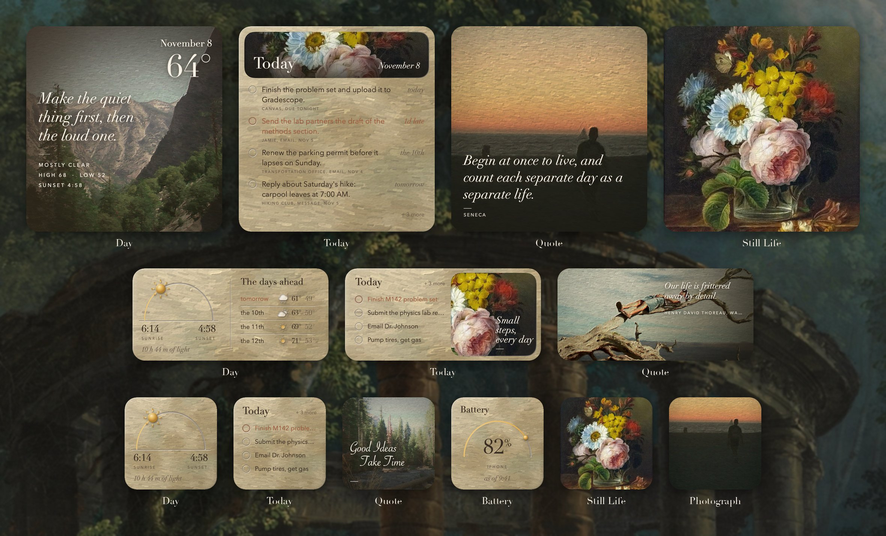
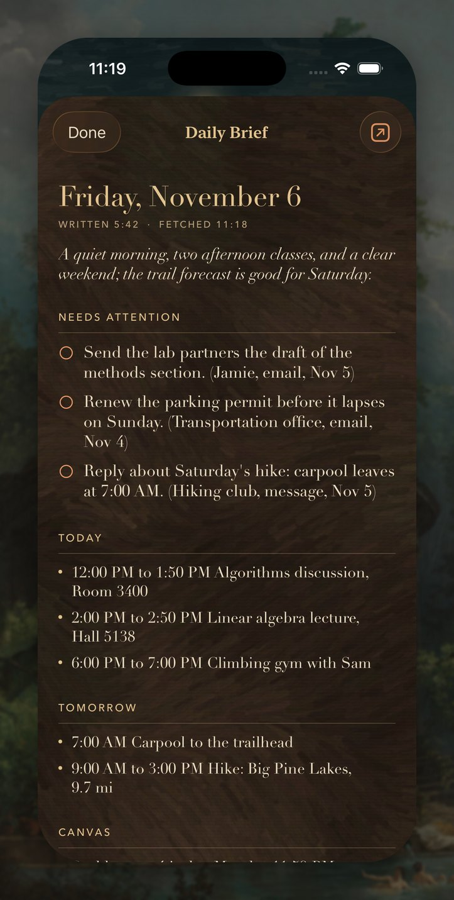
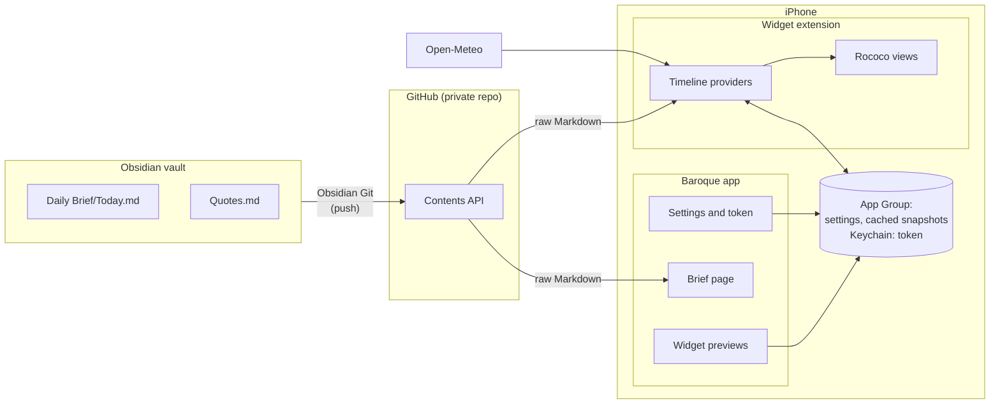
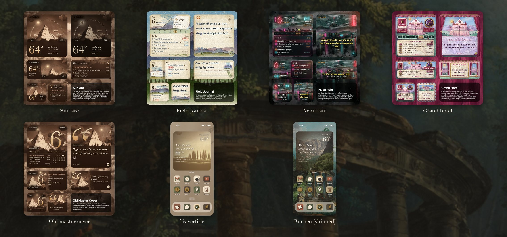

# Baroque

**Painted iPhone home screen widgets, fed by an Obsidian vault.**

Baroque turns the home screen into an eighteenth-century painting. The widgets are cut from oil-painted limestone with carved lines and raised gold, set in Didot. They sit on Hubert Robert's *The Bathing Pool*, and they show the day's weather, the tasks and quotes kept in an [Obsidian](https://obsidian.md) vault, the morning's daily brief, and the author's own landscape photographs repainted in the painting's colours. The 24 app icons were modelled and rendered in Blender to match.

It's a personal project: a SwiftUI app and WidgetKit extension with no third-party dependencies, which runs on a free Apple ID.


<sub>The author's iPhone 15 Pro, with the widgets showing demo data.</sub>

## The widgets



| Widget | Sizes | Shows | Reads |
| --- | --- | --- | --- |
| **Day** | S M L | The sun's path across a carved arc, sunrise and sunset, hours of light. Medium adds the days ahead; large is one of the author's repainted landscapes, a new one every three hours, with the date, the temperature, a quote and the weather. | Open-Meteo (no key) |
| **Today** | S M L | Today's tasks on painted stone, overdue ones in terracotta. Large gives each task room for two lines, its due note and where it came from. Tapping it opens the whole Daily Brief. | The vault |
| **Quote** | S M L | A line from the vault on a repainted photograph. Tapping the quote shows the next one. | The vault |
| **Battery** | S | The iPhone's charge, inlaid in gold. | The phone |
| **Still Life** | S L | The flower still life, and nothing else. | Nothing |
| **Photograph** | S | One of the author's repainted photographs and nothing else, a new one every three hours, never the one the large Day widget is showing. | Nothing |

Every widget keeps drawing with its last data when the phone is offline, and puts a readable error line on itself when a fetch fails.

### The Daily Brief



The Today widget's tasks come from `Daily Brief/Today.md`, a note an automated morning brief rewrites in the vault every day. Tapping the widget opens the whole note in the app, set out like the note itself: the summary, the tasks that need attention, the day's schedule and the rest. It works offline from the last copy, and an Open in Obsidian button opens the note itself.

The vault formats are documented in [`examples/`](examples/): tasks are [Obsidian Tasks](https://publish.obsidian.md/tasks/) lines (`- [ ] #todo Text ⏫ 📅 2026-06-05`), and quotes are blockquotes, bullets or lines in quotation marks.

<br clear="right">

## How it works



- **Two targets, one codebase.** The app and the widget extension compile the same `Shared/` folder: models, the Markdown parsers, the GitHub and weather clients, the cache and the rococo views. The app holds the settings and the token and previews every widget; the extension draws them.
- **The vault on GitHub.** The vault is pushed to a private GitHub repo by the Obsidian Git plugin. The widgets read the Markdown they need through the Contents API with a read-only fine-grained token. There's no server.
- **Shared storage.** Settings and cached snapshots live in an App Group's `UserDefaults`, and the token in a Keychain access group, so both targets see them. Every fetch writes a snapshot, and every widget draws from the newest one it has, which is how they work offline.
- **Timelines.** Day and Today refresh about every 30 minutes and at midnight. Quote lays out six rotations ahead on wall-clock slots, and an App Intent button moves it on. Battery reads the phone every 15 minutes, and Still Life never needs to refresh.
- **One layout per size.** Each widget is laid out once at the iPhone 17 size and scaled to fill the phone's own widget, so the paintings are composed around the words.

The details are in [docs/ARCHITECTURE.md](docs/ARCHITECTURE.md).

## The art

Nothing in the widgets is a flat colour or a stock texture. Everything is generated offline and deterministically by scripts in the repo:

- **Painted limestone:** `scripts/make_textures.py` paints the stone and the reliefs with oil strokes in the colours of *The Bathing Pool*.
- **Repainted photographs:** `MockLab/Textures/rococo/photos.py` moves the author's photographs into the painting's palette with a Lab colour transfer. It then lays fine brush strokes along the image's own structure (a structure tensor), with bristle texture, impasto, canvas weave and varnish. The photos never leave the Mac they're processed on.
- **The icons:** 24 icons and the app icon are 3D models built and rendered headless in Blender (`MockLab/Textures/travertine/icons/build.py`), then painted to match.
- **The catalog:** `scripts/export_rococo_textures.py` cuts everything to its frame at 2 px per point, because WidgetKit refuses a widget whose images are too large.

More in [docs/ART.md](docs/ART.md).

## The design lab



`MockLab/` is a macOS Swift package of design experiments, one executable per look. Each renders the widgets and a board with demo data, which made it cheap to try very different directions before porting one into the app. Among them:
- **Film looks:** after Wong Kar-wai and Wes Anderson.
- **Old Master Cover:** a sepia oil look with the Matterhorn traced from a photograph.
- **Weather-first layouts.**
- **Travertine:** a stone set from a Pinterest reference.
- **Ideas for the next small widgets:** in [docs/WIDGET_IDEAS.md](docs/WIDGET_IDEAS.md).

## Build it

You need a Mac with Xcode 16 or later and [XcodeGen](https://github.com/yonaskolb/XcodeGen). For a device you also need any Apple ID; a paid developer account isn't required.

```sh
xcodegen generate                       # Baroque.xcodeproj from project.yml
open Baroque.xcodeproj                  # run the Baroque scheme on a simulator; no signing needed
cd ParserTests && swift test            # the parser tests
```

For your own iPhone:
1. Copy `Config/Local.example.xcconfig` to `Config/Local.xcconfig` and put your team ID in it.
2. Tick the App Group once in Xcode's Signing & Capabilities.
3. Run `scripts/install_on_iphone.sh`.
4. In the app, enter your vault's repository and a fine-grained token with read-only access to its contents.

[docs/SETUP.md](docs/SETUP.md) walks through all of it, including the home screen: icons made with Shortcuts, the wallpaper and the widgets.

## Repository

```
Shared/          code compiled into both the app and the widget extension
Baroque/         the app: settings, widget previews, the Brief page, home screen setup
BaroqueWidget/   the widget extension
BaroqueUITests/  UI tests that place the widgets on a simulator home screen for screenshots
ParserTests/     a Swift package that tests the parsers against real-shaped Markdown
MockLab/         the design lab (macOS Swift package)
scripts/         painting, export, install, screenshot and iPhone Mirroring tools
examples/        example vault files
docs/            architecture, setup, art pipeline, widget ideas, history
```

## Credits

- **The Bathing Pool.** Hubert Robert, 1777–80, The Metropolitan Museum of Art (Open Access, public domain).
- **The Swing.** Jean-Honoré Fragonard, 1767, the Wallace Collection (public domain). It appears only in MockLab's alternative wallpapers.
- **The flower still life.** A nineteenth-century oil of a bouquet in a glass; the painter is not yet identified.
- **The photographs.** The landscapes are the author's own.
- **The Matterhorn skyline** in MockLab's Old Master look is traced from Wikimedia Commons, `File:Matterhorn_Riffelsee_2005-06-11.jpg`.
- **Weather** by [Open-Meteo](https://open-meteo.com) (CC BY 4.0).
- **Fonts.** Didot, Avenir Next and Savoye LET are system fonts on Apple platforms and aren't included.
- **Trademarks.** The home screen icons depict the logos of third-party apps (Gmail, Spotify, Slack, Netflix and others) for the author's personal home screen. The trademarks belong to their owners, and this project isn't affiliated with them.

## License

The code is under the [MIT License](LICENSE). The paintings are public domain. The photographs and their repainted versions are © the author, and aren't covered by the code license.
