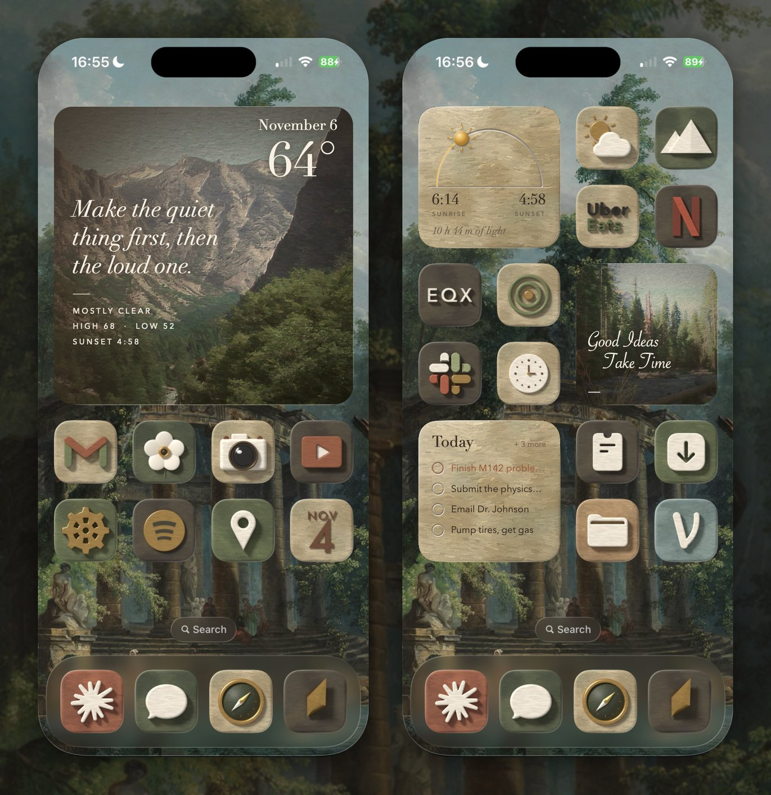

# Baroque

Painted iPhone home screen widgets, fed by an Obsidian vault. SwiftUI and WidgetKit, no dependencies.



## Widgets

- **Day:** sunrise, sunset and the weather. The large size shows a repainted photograph with a quote.
- **Today:** today's tasks from the vault; tick one to mark it done there. The large size shows the brief's picture of the day. Tap it to read the whole daily brief.
- **Quote:** a quote from the vault, with who said it. Tap it for the next one.
- **Days Ahead, Battery, Still Life and Photograph:** the next four days' weather, the iPhone's charge, the flower painting, a photograph.

When the phone is offline, the widgets keep showing the last data they fetched.

## Build

You need Xcode 16 or later and [XcodeGen](https://github.com/yonaskolb/XcodeGen). A free Apple ID is enough.

```sh
xcodegen generate
open Baroque.xcodeproj
```

To put it on an iPhone, see [docs/SETUP.md](docs/SETUP.md). How it works: [docs/ARCHITECTURE.md](docs/ARCHITECTURE.md).

## Credits

The wallpaper is Hubert Robert's *The Bathing Pool* (The Met, public domain), and the weather comes from [Open-Meteo](https://open-meteo.com) (CC BY 4.0). The home screen icons show third-party app logos; their trademarks belong to their owners. The full list of credits is in [docs/ART.md](docs/ART.md#credits).

## License

The code is under the [MIT License](LICENSE). The photographs and their repainted versions are © the author and aren't covered by it.
