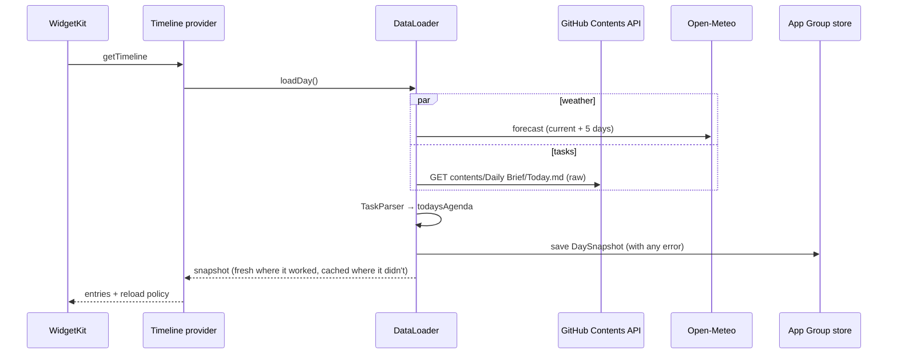

# Architecture

Baroque is three things that ship together, plus two that don't:

| Part | What it is | Where |
| --- | --- | --- |
| The app | Settings, the token, live widget previews, the Daily Brief page, home screen setup | `Baroque/` |
| The widget extension | Five widgets and their timelines | `BaroqueWidget/` |
| Shared code | Only what both need: models, parsers, the GitHub and weather clients, the loader and cache, the rococo views | `Shared/`, compiled into both |
| Parser tests | A Swift package that tests the real `Shared/` parsers through symlinks | `ParserTests/` |
| The design lab | A macOS Swift package that renders widget looks as images | `MockLab/` |

`project.yml` is the source of truth for the Xcode project (XcodeGen). No third-party packages are used anywhere.

## Data flow

### Reading the vault

The vault is an Obsidian folder that the Obsidian Git plugin pushes to a private GitHub repository. `GitHubClient` fetches one file at a time through the Contents API with `Accept: application/vnd.github.raw+json`. That returns the raw Markdown for private repositories, given a fine-grained token with read-only Contents permission on that one repository. Paths are percent-encoded segment by segment, so folders with spaces (`Daily Brief/Today.md`) work.

`Parsers.swift` holds two parsers and the agenda:

- **`TaskParser`** reads [Obsidian Tasks](https://publish.obsidian.md/tasks/) lines: `- [ ] #todo Text ⏫ 📅 2026-06-05`.
  - It reads the priority emoji (🔺 ⏫ 🔼 🔽 ⏬) and the due date.
  - It cleans the inline Markdown (wiki links, bold, block IDs).
  - It skips done tasks.
- **`TaskParser.todaysAgenda`** orders the tasks into buckets: overdue, due today, undated high priority, due within a few days, other undated, later. Inside a bucket it sorts by priority, then due date, then the order in the note.
- **`QuoteParser`** reads three shapes:
  - blockquotes followed by an author line starting with a dash;
  - bullets (`- "text" — Author`);
  - lines that open with a quotation mark (`“text” - Author`).

  Headings and other prose are ignored, so the quotes file can be organised freely.

The task paths are a setting: one vault path per line, where `{daily}` expands to today's daily note (`daily note/MM.dd.yyyy - EEEE.md` by default). The default is the Daily Brief.

### Weather

`WeatherClient` asks Open-Meteo for the current conditions and five days of highs, lows, weather codes, sunrise, sunset and the chance of rain, in one request. Open-Meteo needs no key and no account. The location is set once in the app, from Core Location or typed in.

### One fetch for every widget

It fetches once and serves every widget. Day and Today share a provider, and iOS asks for each widget kind and size on its own schedule, so one refresh of the home screen used to fetch the same weather and brief once per widget. `DataLoader.loadDay()` and `loadQuotes()` now return the stored snapshot if it's less than 15 minutes old (and, for the day, from today). The app's Save & Refresh passes `maxAge: 0` to fetch fresh, and the widgets it then reloads reuse that fetch.

### Storage

`Store` is the one place both targets read and write:

| Key | Contents |
| --- | --- |
| `baroque.settings` | `BaroqueSettings`: repository, paths, location, units, limits |
| `baroque.daySnapshot` | weather, the agenda and any errors, with the time of the fetch |
| `baroque.quoteSnapshot` | the parsed quotes |
| `baroque.quoteOffset` | how far the next-quote button has moved the rotation |
| `baroque.brief` | the last Daily Brief fetched in full |

They live in the App Group's `UserDefaults` (`group.com.ryanfernandez.terra`). Settings decode field by field, so a field added in a later version takes its default instead of resetting what was entered. The token is in the Keychain, in an access group both targets share, and falls back to the App Group's defaults on the simulator, where there's no access group without signing.

### Offline and errors

Every load records what failed instead of throwing:
- The snapshot keeps the newest data it has: fresh where the fetch worked, cached where it didn't. The weather is cached only for the day it was fetched.
- The error goes in the snapshot too, and each widget sets it on its last line ("GitHub rejected the token (401)", "Not found: …", "No GitHub token…").

So a widget that can't reach the network still draws, and says why it's stale.

## Widgets

| Kind | Provider | Refresh | Tap |
| --- | --- | --- | --- |
| `BaroqueDay` | `DayProvider` | every 30 min and at midnight | opens the app |
| `BaroqueToday` (S M L) | `DayProvider` | the same | `baroque://brief`: the Daily Brief page |
| `BaroqueQuote` | `QuoteProvider` | six entries ahead on wall-clock slots (every 60 min by default) | `NextQuoteIntent`: the next quote |
| `BaroqueBattery` | `BatteryProvider` | every 15 min (reads `UIDevice` in the extension) | opens the app |
| `BaroqueStillLife` | `StillLifeProvider` | never | opens the app |
| `BaroquePhotograph` (S) | `PhotographProvider` | a day of three-hour turns laid out ahead; nothing to fetch | opens the app |

**Quote rotation.** The quote for a time slot is `(offset + slot) % count`, where the slot is the wall-clock time divided by the rotation length, so the sequence keeps its place across reloads. `NextQuoteIntent` (an App Intent behind a `Button` in the widget) bumps `quoteOffset` and reloads only the Quote timelines. The large Day widget shows the quote one past the Quote widget's, so the two never match.

**Photographs.** `RococoPhotos` takes the author's repainted photographs in turn, a new one every three hours on the local clock (midnight, 3, 6 …). The large Day widget uses the six landscapes with no one where its quote sits; the Photograph widget uses all ten and never shows the one the Day widget is showing. The Day provider adds an entry at the next change when it falls before its next refresh, so the photograph changes on time.

**Layout.** Every rococo view is laid out once at its iPhone 17 size: small 164, medium 348 × 164, large 348 × 365 points. `RococoFrame` scales that layout to fill whatever size the phone gives the widget, with every layout keeping 14 points clear of the edges for the crop. The paintings are composed around the words, and words on a picture always sit on its darkened side, which is darker again at night.

**Images.** WidgetKit refuses to draw a widget whose images add up to too many pixels. The widget images are JPEGs cut to their frame at 2 pixels per point, so the largest is 696 × 730. `widgetAccentedRenderingMode(.fullColor)` keeps the paintings in colour when the home screen is set to clear or tinted.

## The app

The app compiles two files of its own on top of `Shared/`: `Theme.swift` and `Landscape.swift` paint its backdrop (the sky that follows the time of day, the ridges, the stone panels), building on `Shared/Sky.swift`. The widgets need only `Sky.swift`.

`ContentView` is a single form:
- **The previews:** the real rococo views with the cached snapshots.
- **Settings:** the repository, the token, the paths and the location.
- **Home screen setup.**
- **The icons.**
- **Save & Refresh:** stores the settings, fetches, and reloads every timeline.

`BriefView` fetches `Daily Brief/Today.md` and sets it out block by block: the title, the summary, the sections, tasks with rings, bullets. It caches the note in `Store.brief`.

### Home screen setup

iOS lets no app move icons, set the wallpaper or place widgets, so the app hands over the pieces:
- **The icons:** the app keeps the 24 icons as files under Files › On My iPhone › Baroque, so each icon can be made as a Shortcuts **Open App** shortcut added to the Home Screen with its picture.
  - A web clip from a configuration profile looks the same but opens Safari before the app.
  - The profile key that would avoid that, `TargetApplicationBundleIdentifier`, works only in profiles installed by an MDM server.
- **The wallpaper:** saved to Photos.
- **The plan:** a drawing of the dock and pages.

`scripts/mirror_setup.py` can do the tapping through macOS's iPhone Mirroring. It photographs the mirrored screen and reads it with Vision (`scripts/mirror/ocr.swift`), recognises the icons by their pictures, and taps and drags with `cliclick`. Its docstring records what mirroring does with synthetic input. For example, a drag that starts on an icon picks it up immediately, and Return arrives only through System Events.

### Debug launch arguments

`Baroque/DebugLaunch.swift` and `WidgetRenders.swift` (debug builds only):

| Argument | Does |
| --- | --- |
| `-resetData` | fresh-install state |
| `-seedDemoData` | demo tasks and quotes in the cache |
| `-renderWidgets` | exact-size PNGs of every widget state at three phone sizes, into the app's Documents |
| `-scrollTo <section>` | opens the form at a section (`github`, `setup`, `icons`, …) |
| `-briefFile <path>` | a Daily Brief read from a file |
| `-openBrief` | opens the Brief page |
| `-saveIcons` | saves the 24 icons to Photos in home screen order |

## Tests

- **Parser tests:** `ParserTests/` tests the parsers, the agenda ordering and the daily note paths against real-shaped Markdown (`cd ParserTests && swift test`).
- **UI tests:** `BaroqueUITests/` drives SpringBoard on the simulator to place each widget on the home screen and screenshot it, fresh, cached and with a bad token (`scripts/capture_screenshots.sh`).

## The design lab

`MockLab/` has one executable per look. A look renders the six widget states and a board to `MockLab/out/<look>/` with fixed demo data, and the harness links the app's own models through symlinks.
- **The painted looks** link `PaintKit/`, which compiles the app's `Theme` and `Landscape`, the retired views (the Old Master Cover look and the first painted-night set) and both image catalogs: the app's and `Archive.xcassets`.
- **`RSmalls`** links the shipped `Shared/Rococo*.swift`. It renders the small widget ideas, and with `README=1` it renders the README's pictures.
