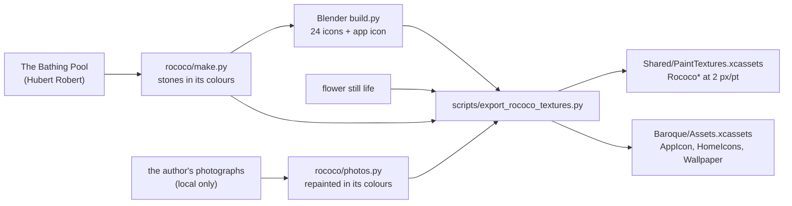

# The art pipeline

Every image in the widgets is generated by a script in this repo, offline and deterministically: fixed seeds, no network, the same picture every run. The rule is to edit the script and run it again rather than touch a PNG.



## The stroke painter

`scripts/make_textures.py` lays everything down as brush strokes:
1. A soft colour field.
2. Opaque strokes over it, coarse to fine, following a direction field. Each stroke picks up the colour under where it starts, plus a little jitter, the way paint is dragged across a board.
3. Fine bristle marks and edge lighting (impasto) on top, so the paint itself has relief.

It makes two kinds of image:
- **Colour textures:** JPEGs.
- **Relief overlays:** PNGs of light and dark brushwork only, laid at run time over colours SwiftUI chooses. The app's sky follows the time of day this way.

`MockLab/Textures/rococo/make.py` uses the same painter for the limestone the widgets are cut from. It's in *The Bathing Pool*'s own colours: the weathered stone of its pedestals and steps, the greens of the grove, the teal of the sky, the terracotta of the flower pots. It also cuts the painting to the phone's screen for the wallpaper.

### How much paint shows

The widgets lay the painted limestone at 28 percent over a light stone colour (`RococoTheme.quiet`). At full strength the brushwork made small text hard to read, so the texture is kept as a quiet surface, and every text colour on it meets 4.5:1 contrast. `RococoTheme` holds the other options that were compared, and `scripts/compare_themes.py` lays them side by side on a home screen.

## Repainting the photographs

`MockLab/Textures/rococo/photos.py` repaints the author's landscape photographs as Robert or Fragonard might have:
1. **Colour.** Each photo's colours move two thirds of the way toward the paintings'. The mean and spread of each channel are matched in Lab. The highlights are eased and the shadows deepened, the way an old canvas holds them.
2. **Strokes.** It's repainted with strokes that follow its forms, along the direction of least change from the image's structure tensor. Where the image is flat (a sky), the strokes lie level, as Robert lays one in. Broad strokes go everywhere, then smaller ones, then fine ones only where there's detail.
3. **Surface.** The paint gets bristle marks and ridges lit from the upper left, a canvas weave, a warm varnish and darker corners.

The photos are read from the Mac's Pictures folder and processed there. Only the repainted versions, with no metadata, are kept.

## The icons

`MockLab/Textures/travertine/icons/build.py` runs headless in Blender:

```sh
ICON_SET=rococo /Applications/Blender.app/Contents/MacOS/Blender -b -P MockLab/Textures/travertine/icons/build.py
```

Each icon is a slab of painted stone in the iOS icon shape, with its object raised on it and lit from the upper left. The objects are of two kinds:
- **Traced outlines, extruded with rounded edges:** from SF Symbols and type, by `glyphs.swift` and `trace.py`.
- **Modelled shapes:** the flower, the camera, the compass, the calendar, the clock and the gem.

Neighbouring icons alternate light and dark stone. The app icon is the Day widget's sun arc in gold.

## Into the app

`scripts/export_rococo_textures.py` cuts every source to its frame, as JPEG at 2 pixels per point:

| Image | Size | Used by |
| --- | --- | --- |
| `RococoLimestone` | 480 × 480 | the stone widgets |
| `RococoHero` | 696 × 730 | large Day (a repainted Kings Canyon) |
| `RococoTall`, `RococoWide`, `RococoSquare` | 696 × 730, 696 × 328, 328 × 328 | Quote, large to small |
| `RococoFlowers` | 304 × 296 | medium Today's panel |
| `RococoStillLife`, `RococoStillLifeLarge` | 328 × 328, 696 × 730 | Still Life |

WidgetKit refuses a widget whose images add up to too many pixels, so no widget uses more than one large image. The same script writes the app icon, the 24 home screen icons (512 px, opaque) and the wallpaper into `Baroque/Assets.xcassets`.

## The README's pictures

The README's pictures use demo data only:

```sh
cd MockLab && README=1 swift run --scratch-path .build-smalls RSmalls
cd .. && PAGE1=… PAGE2=… BRIEF=… python3 scripts/readme_images.py
```

How each picture is made:
- **The widget renders:** MockLab's `RSmalls` renders the shipped widget views, in the design sizes and in the sizes the author's phone draws them.
- **The home screen pictures:** `readme_images.py` lays those renders onto screenshots of the phone (wallpaper, icons, dock).
- **The widget sheet and the design-lab sheet:** also from `readme_images.py`.
- **The Brief page:** from the simulator, launched with `-briefFile examples/Daily\ Brief/Today.md -openBrief`.

## Credits

- **The Bathing Pool.** Hubert Robert, 1777–80, The Metropolitan Museum of Art (Open Access, public domain).
- **The Swing.** Jean-Honoré Fragonard, 1767, the Wallace Collection (public domain). It appears only in MockLab's alternative wallpapers.
- **The flower still life.** A nineteenth-century oil of a bouquet in a glass; the painter is not yet identified.
- **The photographs.** The landscapes are the author's own.
- **The Matterhorn skyline** in MockLab's Old Master look is traced from Wikimedia Commons, `File:Matterhorn_Riffelsee_2005-06-11.jpg`.
- **Weather** by [Open-Meteo](https://open-meteo.com) (CC BY 4.0).
- **Fonts.** Didot, Avenir Next and Savoye LET are system fonts on Apple platforms and aren't included.
- **Trademarks.** The home screen icons depict the logos of third-party apps (Gmail, Spotify, Slack, Netflix and others) for the author's personal home screen. The trademarks belong to their owners, and this project isn't affiliated with them.
